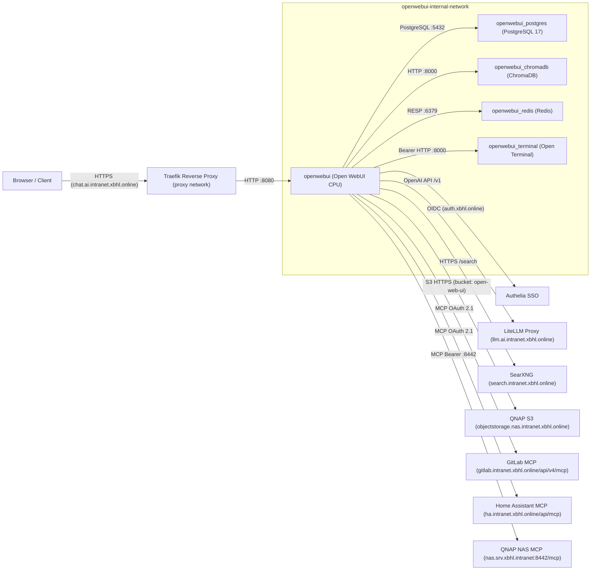

# Open WebUI

> Version: `v0.12.5` | Images: `ghcr.io/open-webui/open-webui:v0.12.5`, `chromadb/chroma:1.5.9`, `postgres:17.11`, `redis:8.10.3`, `ghcr.io/open-webui/open-terminal:0.14.6` | Upstream: <https://github.com/open-webui/open-webui>

Self-hosted AI workspace (`Chat XBHL`) backed by internal LiteLLM inference, PostgreSQL, ChromaDB vector search, Redis state coordination, QNAP NAS S3 object storage, SearXNG web search, Open Terminal execution, direct Model Context Protocol (MCP) tool servers, and Authelia OpenID Connect (OIDC) Single Sign-On.

## Service Overview

| Property | Value |
| :--- | :--- |
| **Domain** | `https://chat.ai.intranet.xbhl.online` |
| **Primary Node** | `infrastructure.vm.xbhl.intranet` (VM) |
| **Deploy Path** | `/opt/containers/openwebui` (`delete-existing-container-files: true`, `container-healthcheck-delay: 180`) |
| **Ingress Strategy** | Internal Traefik (`proxy` Docker network, `websecure` TLS router `openwebui-router` -> `http://openwebui:8080`, Cloudflare DNS `direct`) |
| **Topology Archetype** | 5-container multi-service AI workspace stack (`openwebui`, `chromadb`, `postgresdb`, `redis`, `openterminal`) |
| **Authentication** | Native Authelia OIDC SSO (`https://auth.xbhl.online`, confidential client `mnDs7U359iJiBJLmHTkMDjIVeEoeAobQCa0NjDss`, `two_factor` policy, CORS origin `https://chat.ai.intranet.xbhl.online`); local password and signup forms disabled; no Traefik `forwardAuth` |
| **Ecosystem** | WUD (`wud.watch=true` on all 5 containers); Gatus (`src/config/open-webui.yaml`, group `open-webui`: `/health`, `/health/db`, authenticated `/api/models`, and container health); Authelia OIDC (`clients.yaml` & `identity_providers.yaml`); not listed in `home-lab/homepage` |

## Architecture & Communication

### Container & Volume Matrix

| Compose Service | Container Name | Networks | Named Volume | Healthcheck & Startup Dependency |
| :--- | :--- | :--- | :--- | :--- |
| `openwebui` | `openwebui` | `openwebui-internal-network`, `proxy` | `data:/app/backend/data` | `curl -f http://localhost:8080/health` (`start_period: 60s`); waits for healthy `chromadb`, `postgresdb`, `redis`, and `openterminal` |
| `chromadb` | `openwebui_chromadb` | `openwebui-internal-network` | `chromadb:/data` | TCP probe on `localhost:8000` (`IS_PERSISTENT=TRUE`) |
| `postgresdb` | `openwebui_postgres` | `openwebui-internal-network` | `postgresdb:/var/lib/postgresql/data` | `psql -U openwebui -d openwebui -c 'SELECT 1'` (`shm_size: 128mb`) |
| `redis` | `openwebui_redis` | `openwebui-internal-network` | `redis:/data` | `redis-cli ping` |
| `openterminal` | `openwebui_terminal` | `openwebui-internal-network` | `openterminal:/home/user` | `curl -f http://localhost:8000/health` (`start_period: 15s`) |

### Service Integrations & CI Pipeline

- **LiteLLM Unified AI Gateway (`src/envs/ai.env`, `src/envs/webui.env`)**: Disables direct Ollama access (`ENABLE_OLLAMA_API=False`) and routes all OpenAI-compatible workloads (`ENABLE_OPENAI_API=True`) through `https://llm.ai.intranet.xbhl.online/v1` using `XBHL_LITELLM_API_KEY`: default chat (`DEFAULT_MODELS=xbhl/chat`), speech-to-text (`AUDIO_STT_ENGINE=openai`, `xbhl/transcribe`), text-to-speech (`AUDIO_TTS_ENGINE=openai`, `xbhl/tts`, `AUDIO_TTS_VOICE=alloy`), image generation and editing (`IMAGE_GENERATION_ENGINE=openai`, `IMAGE_EDIT_ENGINE=openai`, `xbhl/image` at `1024x1024`, `ENABLE_IMAGE_EDIT=True`), and RAG embeddings (`RAG_EMBEDDING_ENGINE=openai`, `xbhl/embed`). Sub-agents (`ENABLE_SUBAGENTS=True`, max `20` concurrent / `20` async), folders, notes, memories, API keys, and `en,pl` YouTube transcript loading are enabled with `DEFAULT_LOCALE=pl`, `DEVICE_TYPE=cpu`, `ENABLE_PERSISTENT_CONFIG=False`, and `ENABLE_CHANNELS=False`.
- **SearXNG Web Search (`src/envs/ai.env`)**: Enables web search and search query generation (`ENABLE_WEB_SEARCH=True`, `ENABLE_SEARCH_QUERY_GENERATION=True`, `WEB_SEARCH_ENGINE=searxng`) against `https://search.intranet.xbhl.online/search?q=<query>` (`WEB_SEARCH_RESULT_COUNT=5`, `WEB_LOADER_CONCURRENT_REQUESTS=10`).
- **Databases & QNAP S3 Storage (`src/envs/db.env`, `src/envs/postgres.env`, `src/envs/storage.env`)**: Application metadata is stored in `postgresdb` (`PostgreSQL 17`), vector embeddings in `chromadb` (`VECTOR_DB=chroma`, `chromadb:8000`), coordination/cache state in `redis` (`redis://redis:6379`), local runtime files in `data:/app/backend/data`, and user uploads in QNAP NAS Object Storage (`STORAGE_PROVIDER=s3`, `https://objectstorage.nas.intranet.xbhl.online`, bucket `open-web-ui`, region `fake-xbhl-region`, access key `ObjectStorage:rulXEuaMLAM1B72isDW1`).
- **Open Terminal, Direct MCP Tool Servers & Pipelines (`src/envs/terminal.env`, `src/config/tool_servers.json`, `src/envs/ai.env`)**: No `open-webui/pipelines` container is deployed. Instead, sandboxed terminal execution runs in `openterminal` (<https://github.com/open-webui/open-terminal>, `http://openterminal:8000`, OpenAPI spec `/openapi.json`, shared Bearer token `OPEN_TERMINAL_API_KEY` / `TERMINAL_SERVER_CONNECTIONS`), while external tool integrations (`ENABLE_TOOL_SERVERS=True`, `ENABLE_DIRECT_INTEGRATIONS=True`) are defined in `src/config/tool_servers.json` and inlined into `TOOL_SERVER_CONNECTIONS`:
  - `gitlab` (`https://gitlab.intranet.xbhl.online/api/v4/mcp`, per-user `oauth_2.1`).
  - `home-assistant` (`https://ha.intranet.xbhl.online/api/mcp`, per-user `oauth_2.1`).
  - `qnap-nas` (`http://nas.srv.xbhl.intranet:8442/mcp`, shared `bearer` token `QNAP_MCP_TOKEN`).
- **Authelia OIDC Single Sign-On (`src/envs/auth.env`)**: Configures OpenID Connect against `https://auth.xbhl.online/.well-known/openid-configuration` (`OAUTH_PROVIDER_NAME="XBHL Online"`, client ID `mnDs7U359iJiBJLmHTkMDjIVeEoeAobQCa0NjDss`, scopes `openid email profile`, callback `https://chat.ai.intranet.xbhl.online/oauth/oidc/callback`, `ENABLE_OAUTH_SIGNUP=True`, `OAUTH_MERGE_ACCOUNTS_BY_EMAIL=true`, `JWT_EXPIRES_IN=-1`). Local signup and password forms are disabled (`ENABLE_SIGNUP=False`, `ENABLE_LOGIN_FORM=False`, `ENABLE_PASSWORD_AUTH=False`, `ENABLE_PASSWORD_CHANGE_FORM=False`).
- **GitLab CI/CD Build & Deployment Pipeline (`.gitlab-ci.yml`)**: Includes `home-lab/automations/docker-compose-service-deployment` without Compose profiles, so all 5 containers start in both `test:openwebui:docker-compose` (DinD smoke test) and `deploy:openwebui:start-service` (SSH deploy to `infrastructure.vm.xbhl.intranet:/opt/containers/openwebui`). Prior to testing/deployment, `setup:generate-build-artifacts` copies `src/envs` and `src/config` into `$BUILD_ARTIFACTS_DIR/`, enforces non-empty `WEBUI_SECRET_KEY`, `XBHL_LITELLM_API_KEY`, and `QNAP_MCP_TOKEN`, renders secrets into `envs/auth.env`, `envs/ai.env`, `envs/storage.env`, and `config/tool_servers.json`, and inlines single-line JSON into `TOOL_SERVER_CONNECTIONS='...'`.

## Required GitLab CI/CD Variables

| Variable | Scope | Protected | Masked | Purpose |
| :--- | :--- | :--- | :--- | :--- |
| `WEBUI_SECRET_KEY` | Project (`*`) | `false` | `true` | Required (`:?`); injected into `envs/auth.env` (`WEBUI_SECRET_KEY`) to sign sessions and persist encrypted OAuth 2.1 client registrations |
| `OPENWEBUI_OAUTH_CLIENT_SECRET` | Project (`*`) | `true` | `true` | Injected into `envs/auth.env` (`OAUTH_CLIENT_SECRET`) for Authelia OIDC client `mnDs7U359iJiBJLmHTkMDjIVeEoeAobQCa0NjDss` (unguarded so unprotected MR pipelines succeed) |
| `ADMIN_NAME` | Project (`*`) | `false` | `false` | Injected into `envs/auth.env` (`WEBUI_ADMIN_NAME`) for initial bootstrap administrator display name |
| `ADMIN_EMAIL` | Project (`*`) | `false` | `false` | Injected into `envs/auth.env` (`WEBUI_ADMIN_EMAIL`) for initial bootstrap administrator email |
| `ADMIN_PASSWORD` | Project (`*`) | `false` | `true` | Injected into `envs/auth.env` (`WEBUI_ADMIN_PASSWORD`) for initial bootstrap administrator password |
| `XBHL_LITELLM_API_KEY` | Project (`*`) | `false` | `true` | Required (`:?`); replaces `=PLACEHOLDER` across chat, STT, TTS, image, and RAG embedding keys in `envs/ai.env` |
| `QNAP_MCP_TOKEN` | Project (`*`) | `false` | `true` | Required (`:?`); replaces `"QNAP_TOKEN_PLACEHOLDER"` in `config/tool_servers.json` before inlining `TOOL_SERVER_CONNECTIONS` into `envs/ai.env` |
| `S3_SECRET_ACCESS_KEY` | Project (`*`) | `false` | `true` | Injected into `envs/storage.env` (`S3_SECRET_ACCESS_KEY`) for QNAP NAS S3 bucket `open-web-ui` |
| `SSH_USER` | Group `home-lab` (`*`) | `false` | `false` | SSH login user (`vm-ssh-username`) for deployment to `infrastructure.vm.xbhl.intranet` |
| `SSH_PRIVATE_KEY` | Group `home-lab` (`*`) | `false` | `true` | SSH private key (`vm-ssh-private-key`) for deployment to `infrastructure.vm.xbhl.intranet` |
| `CLOUDFLARE_ZONE_ID` | Group `home-lab` (`*`) | `false` | `true` | Cloudflare zone ID (`cloudflare-zone-id`) for `xbhl.online` DNS management |
| `CLOUDFLARE_DNS_API_TOKEN` | Group `home-lab` (`*`) | `false` | `true` | Cloudflare API token (`cloudflare-dns-api-token`) managing the `direct` DNS record for `chat.ai.intranet.xbhl.online` |

> Legacy variables still present in project CI/CD settings (`OAUTH_CLIENT_SECRET`, `OPENAI_API_KEY`, `ANTHROPIC_API_KEY`, `GOOGLE_API_KEY`, `GOOGLE_CLOUD_PROJECT`, `GROK_API_KEY`, `OLLAMA_COM_API_KEY`, `BRAVE_SEARCH_API_KEY`, `GITLAB_MCP_TOKEN`, `HOMEASSISTANT_MCP_TOKEN`) are retired and unreferenced by `.gitlab-ci.yml`.

## Upgrades & Maintenance

- **Upstream & Wrapper Sources**: Standard (tracked via `wud.link.template` across all 5 containers); Open WebUI environment variable schema at <https://docs.openwebui.com/reference/env-configuration/> (authoritative on every startup via `ENABLE_PERSISTENT_CONFIG=False`).
- **Version & Flavor Constraints**: `openwebui` tracks standard `vX.Y.Z` CPU tags (`^v\d+\.\d+\.\d+$$`, `DEVICE_TYPE=cpu`; exclude `:ollama`, `:cuda`, and `:slim` variants); `postgresdb` is pinned to the PostgreSQL 17 major track (`^17\.\d+$$`); `chromadb`, `redis`, and `openterminal` track unprefixed `X.Y.Z` SemVer tags (`^\d+\.\d+\.\d+$$`, with `openterminal` mapping to `v`-prefixed GitHub release tags in `wud.link.template`).
- **Intentional Choices (Do Not Propose)**: `ENABLE_PERSISTENT_CONFIG=False` in `src/envs/webui.env` (GitOps `.env` files override UI DB settings); `ENABLE_OLLAMA_API=False` with chat, STT, TTS, image generation/editing, and RAG embeddings routed exclusively through internal LiteLLM (`https://llm.ai.intranet.xbhl.online/v1`); local password/signup forms disabled (`ENABLE_SIGNUP=False`, `ENABLE_LOGIN_FORM=False`, `ENABLE_PASSWORD_AUTH=False`, `ENABLE_PASSWORD_CHANGE_FORM=False`) in favor of native Authelia OIDC (`https://auth.xbhl.online`) without Traefik forwardAuth; `ENABLE_CHANNELS=False`; web search via internal SearXNG and uploads on QNAP S3 (`STORAGE_PROVIDER=s3`, bucket `open-web-ui`); MCP servers in `src/config/tool_servers.json` connect directly to GitLab and Home Assistant via per-user `oauth_2.1` (not via LiteLLM MCP gateway) and to QNAP NAS via `bearer` token.
- **Upgrade & CI Gotchas**: `setup:generate-build-artifacts` in `.gitlab-ci.yml` uses `|`-delimited `sed` expecting exact `=PLACEHOLDER` and `TOOL_SERVER_CONNECTIONS=` tokens in `src/envs/ai.env`, `"QNAP_TOKEN_PLACEHOLDER"` in `src/config/tool_servers.json` (`tool_servers.json` is not bind-mounted — CI inlines it via `tr -d '\n\r'` into single-quoted `TOOL_SERVER_CONNECTIONS='...'`, so single quotes inside `tool_servers.json` break `.env` parsing), and empty keys in `src/envs/auth.env` and `src/envs/storage.env`; keep `WEBUI_SECRET_KEY`, `XBHL_LITELLM_API_KEY`, and `QNAP_MCP_TOKEN` `protected: false` (and never add a `:?` guard to `protected: true` `OPENWEBUI_OAUTH_CLIENT_SECRET`) so MR DinD test pipelines pass, and keep `WEBUI_SECRET_KEY` persisted in CI to preserve OAuth 2.1 client registrations; keep `OPEN_TERMINAL_API_KEY` synchronized with `TERMINAL_SERVER_CONNECTIONS` in `src/envs/terminal.env`, internal Postgres credentials aligned across `src/envs/db.env`, `src/envs/postgres.env`, and `postgresdb` healthcheck, and `container-healthcheck-delay: 180` / `start_period: 60s` for startup DB migrations (`delete-existing-container-files: true` wipes `/opt/containers/openwebui`, while state persists in named Docker volumes and S3).
