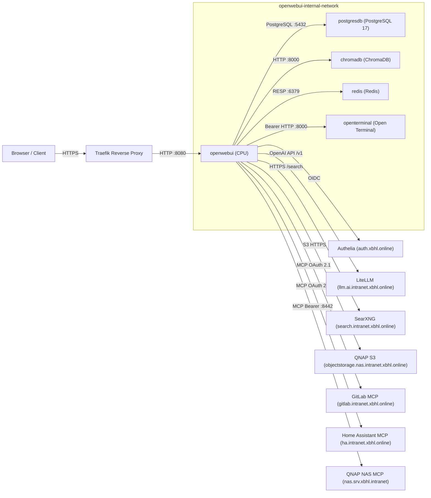

# Open WebUI

> Version: `v0.13.4` | Images: `ghcr.io/open-webui/open-webui:v0.13.4`, `chromadb/chroma:1.5.9`, `postgres:17.11`, `redis:8.10.3`, `ghcr.io/open-webui/open-terminal:0.14.6` | Upstream: <https://github.com/open-webui/open-webui>

Self-hosted AI workspace (`Chat XBHL`) providing a unified chat, RAG, sandboxed terminal, and Model Context Protocol (MCP) tool interface backed by internal LiteLLM inference and Authelia SSO.

## Overview

| Property | Value |
| :--- | :--- |
| **Domain** | `https://chat.ai.intranet.xbhl.online` |
| **Node** | `infrastructure.vm.xbhl.intranet` |
| **Ingress** | Internal Traefik (`proxy` network, `websecure` TLS, Cloudflare `direct` DNS) |
| **Authentication** | Native Authelia OIDC (`two_factor` policy, local login/signup disabled, no Traefik `forwardAuth`) |
| **Ecosystem** | WUD (`wud.watch=true`), Gatus (`/health`, `/health/db`, `/api/models`, container checks), Authelia OIDC |

## Architecture & Key Decisions

- **Delegated LiteLLM Inference**: Open WebUI runs CPU-only with direct Ollama access disabled, routing all chat, speech-to-text, text-to-speech, image generation/editing, and RAG embedding workloads (`xbhl/*` model aliases) through the internal LiteLLM proxy (`https://llm.ai.intranet.xbhl.online/v1`).
- **Split Persistence, Sandbox & Search**: Relational metadata lives in PostgreSQL 17, vector embeddings in ChromaDB, session/websocket coordination in Redis, user uploads in QNAP NAS S3 object storage (`open-web-ui` bucket), sandboxed execution in Open Terminal (no `open-webui/pipelines` sidecar), and web search in internal SearXNG.
- **Declarative GitOps & Native OIDC**: Authentication relies exclusively on native Authelia OIDC (`https://auth.xbhl.online`) with local password/signup forms disabled, while `ENABLE_PERSISTENT_CONFIG=False` keeps repository configuration authoritative over UI database settings on startup.
- **Direct MCP Tool Integrations**: `src/config/tool_servers.json` connects Open WebUI directly to GitLab and Home Assistant MCP servers via per-user OAuth 2.1 (preserving user identity rather than proxying via LiteLLM) and to the QNAP NAS Assist MCP server via shared Bearer auth.

### External Credentials

- `XBHL_LITELLM_API_KEY`: Internal LiteLLM virtual key authorizing `xbhl/*` chat, audio, image, and embedding endpoints on `https://llm.ai.intranet.xbhl.online`.
- `QNAP_MCP_TOKEN` & `S3_SECRET_ACCESS_KEY`: External QNAP NAS credentials authenticating Assist MCP calls (`nas.srv.xbhl.intranet:8442`) and `open-web-ui` S3 bucket storage (`objectstorage.nas.intranet.xbhl.online`).

## Upgrades & Maintenance

- **Upstream & Wrapper Sources**: Standard WUD release tracking across all five containers; Open WebUI configuration reference at <https://docs.openwebui.com/reference/env-configuration/>.
- **Version & Flavor Constraints**: `openwebui` tracks standard `vX.Y.Z` CPU tags (exclude `:ollama`, `:cuda`, and `:slim` variants); `postgresdb` is pinned to the PostgreSQL 17 major track; `chromadb`, `redis`, and `openterminal` track unprefixed `X.Y.Z` SemVer tags.
- **Intentional Choices (Do Not Propose)**: Keep declarative config authoritative (`ENABLE_PERSISTENT_CONFIG=False`), Ollama disabled in favor of LiteLLM, local login/signup disabled in favor of native Authelia OIDC without Traefik `forwardAuth`, uploads on QNAP S3, and GitLab/Home Assistant MCP servers connected directly via per-user OAuth 2.1.
- **Upgrade & CI Gotchas**: `src/config/tool_servers.json` is not bind-mounted — CI strips newlines and inlines it into single-quoted `TOOL_SERVER_CONNECTIONS='...'` after replacing `"QNAP_TOKEN_PLACEHOLDER"`, so single quotes inside `tool_servers.json` break `.env` parsing; keep `WEBUI_SECRET_KEY` persisted across deployments so encrypted OAuth 2.1 MCP client registrations remain decryptable.
